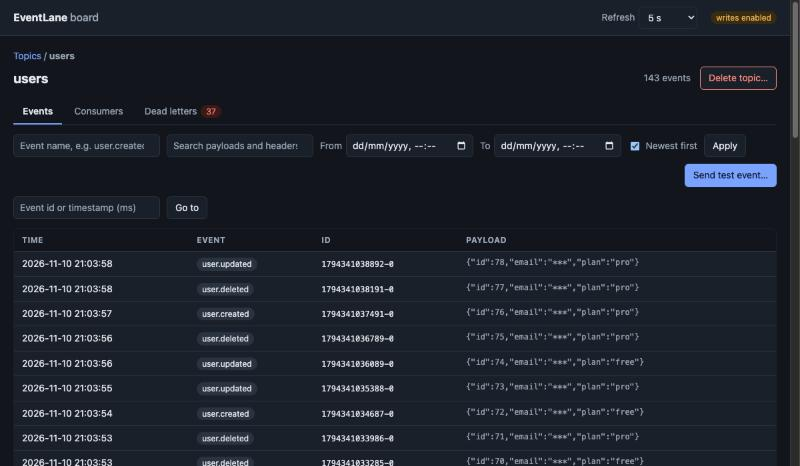

<p align="center">
  <picture>
    <source media="(prefers-color-scheme: dark)" srcset="docs/public/logo-dark.svg">
    
  </picture>
</p>

# EventLane

A lightweight, persistent event bus for Node.js and NestJS, built on Redis Streams: Kafka-like topics and consumers with an `EventEmitter`-like API, for projects that already run Redis (for example for BullMQ) and do not want to operate Kafka or RabbitMQ. A Bull Board style dashboard is included as separate packages.

**[Documentation](https://eventlane-dev.github.io/eventlane/)** · [Getting started](https://eventlane-dev.github.io/eventlane/core/getting-started) · [NestJS](https://eventlane-dev.github.io/eventlane/nestjs/getting-started) · [Dashboard](https://eventlane-dev.github.io/eventlane/dashboard/overview) · [Quick start](https://eventlane-dev.github.io/eventlane/core/quick-start) · [Recipes](https://eventlane-dev.github.io/eventlane/core/recipes) · [Troubleshooting](https://eventlane-dev.github.io/eventlane/core/troubleshooting) · [For AI coding agents](https://eventlane-dev.github.io/eventlane/for-agents)

## Example

```ts
import { EventLaneBus } from '@eventlane/core';

const bus = new EventLaneBus({ redisUrl: process.env.REDIS_URL!, consumerName: 'notifications' });

// listen: topic, event name, handler
bus.on('users', 'user.created', async (payload, meta) => {
  console.log('welcome', payload.email);
});
await bus.start();

// emit from anywhere: the same process or another service
await bus.emit('users', 'user.created', { id: 1, email: 'ada@example.com' });
```

In NestJS the same thing is a decorator:

```ts
@Injectable()
export class NotificationsHandler {
  @OnLaneEvent('user.created')
  async welcome(payload: { id: number; email: string }) {
    // retried automatically when it throws
  }
}

// and where the event happens:
constructor(@InjectLaneEmitter('users') private readonly users: TopicEmitter) {}
// ...
await this.users.emit('user.created', { id: 1, email: 'ada@example.com' });
```

## Install

```bash
npm install @eventlane/core ioredis            # the library, for any Node.js app
npm install @eventlane/nestjs @eventlane/core ioredis   # NestJS module and decorators
```

You need Redis 6.2 or newer with persistence on. The dashboard packages are installed separately; see the [dashboard docs](https://eventlane-dev.github.io/eventlane/dashboard/getting-started).

## Why EventLane

- **Persistent.** Events live in Redis and survive restarts; you can inspect and replay them.
- **Independent consumers.** Every consumer gets every event, and several instances of one consumer share the work.
- **Reliable.** At-least-once delivery, retries with backoff, a dead-letter stream, recovery of events from crashed instances, optional deduplication.
- **Small API.** `emit` and `on`, with topics, event names and consumer names you already know from Kafka.
- **A dashboard** to browse events, find out why something is stuck, retry dead letters and replay history.

It is not Kafka: there are no partitions, no ordering across several instances and no Redis Cluster support, and everything is stored in Redis memory. See [the comparison](https://eventlane-dev.github.io/eventlane/comparison) for when to choose something else.



## Packages

| Package | Path | What it is |
|---|---|---|
| `@eventlane/core` | [packages/core](packages/core) | The framework-independent library (topics, consumers, retries, dead letters, replay, stats). |
| `@eventlane/nestjs` | [packages/nestjs](packages/nestjs) | NestJS module, `@OnLaneEvent`, `@InjectLaneEmitter`. |
| `@eventlane/board-api` | [packages/board-api](packages/board-api) | Framework-neutral JSON API of the dashboard. |
| `@eventlane/board-ui` | [packages/board-ui](packages/board-ui) | The dashboard's web UI (Preact), built to static files. |
| `@eventlane/board-express` | [packages/board-express](packages/board-express) | Mounts the dashboard into Express. |
| `@eventlane/board-fastify` | [packages/board-fastify](packages/board-fastify) | Mounts the dashboard into Fastify. |
| `@eventlane/board-nestjs` | [packages/board-nestjs](packages/board-nestjs) | `BoardModule`: mounts the dashboard into NestJS. |

## Contributing

Issues and pull requests are welcome. How to build, test and run the examples is in [CONTRIBUTING.md](CONTRIBUTING.md); repository conventions are in [AGENTS.md](AGENTS.md).

## License

[MIT](LICENSE)
